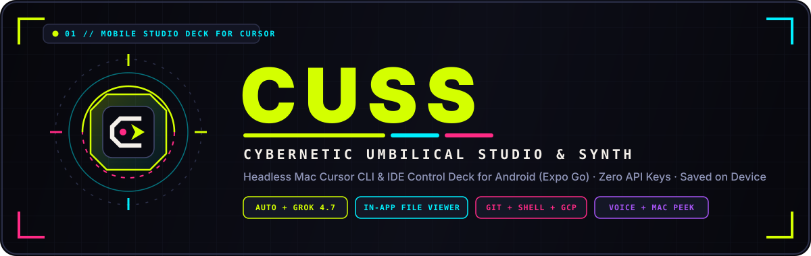
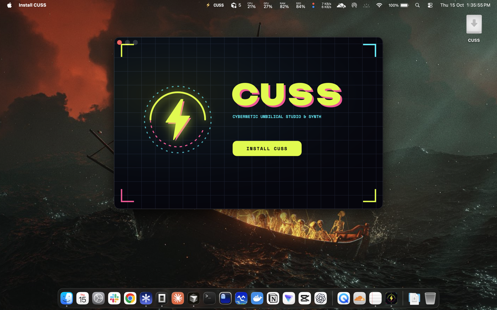
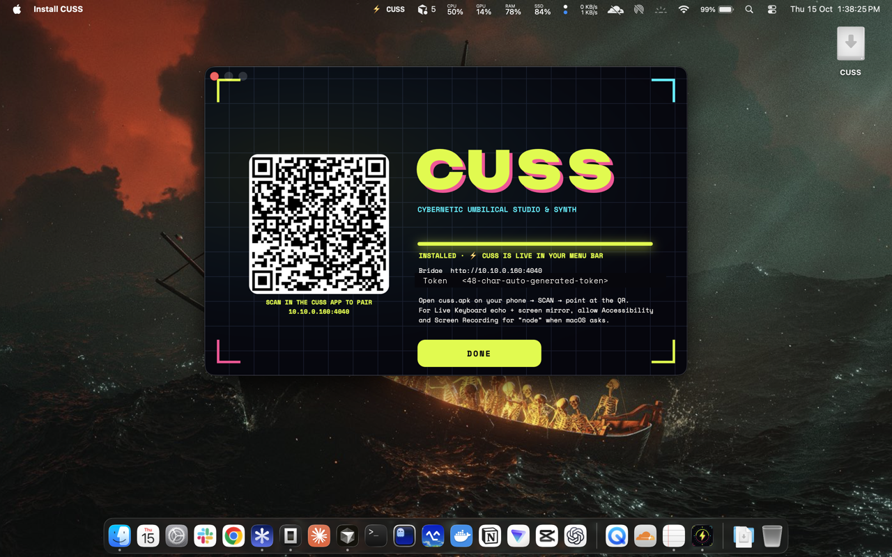
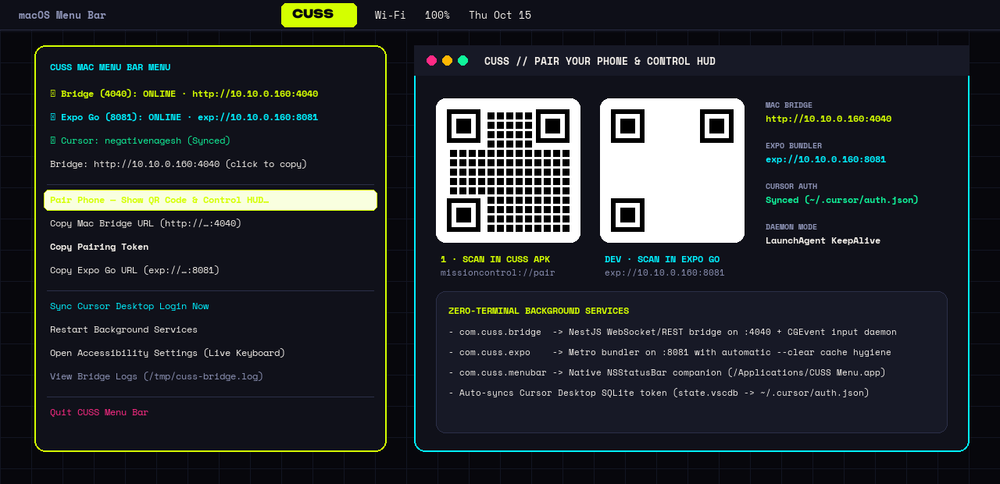
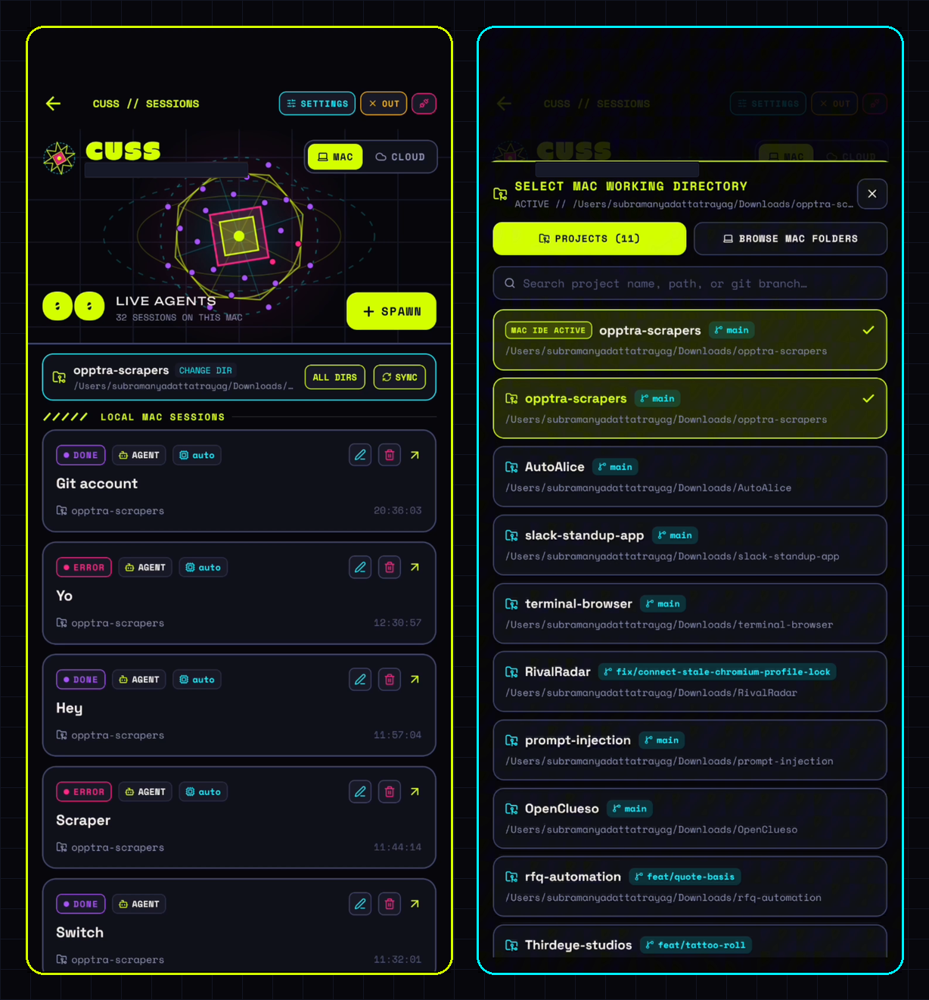
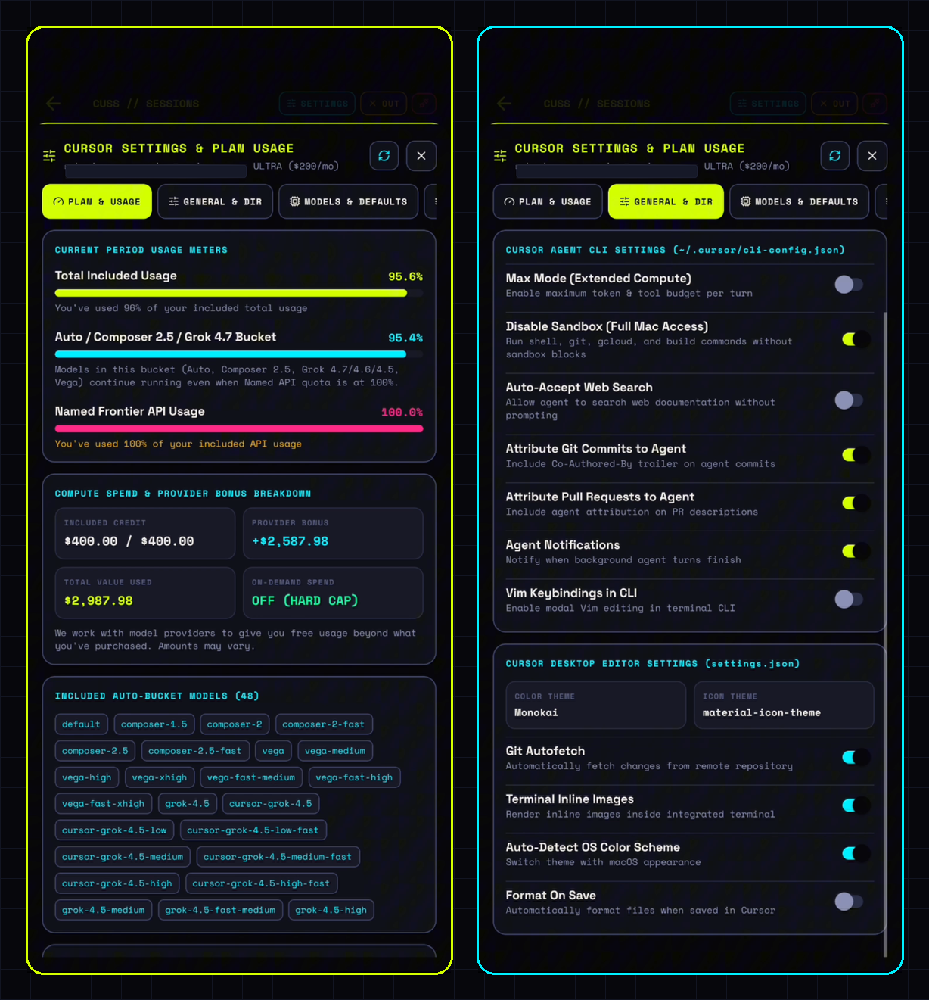
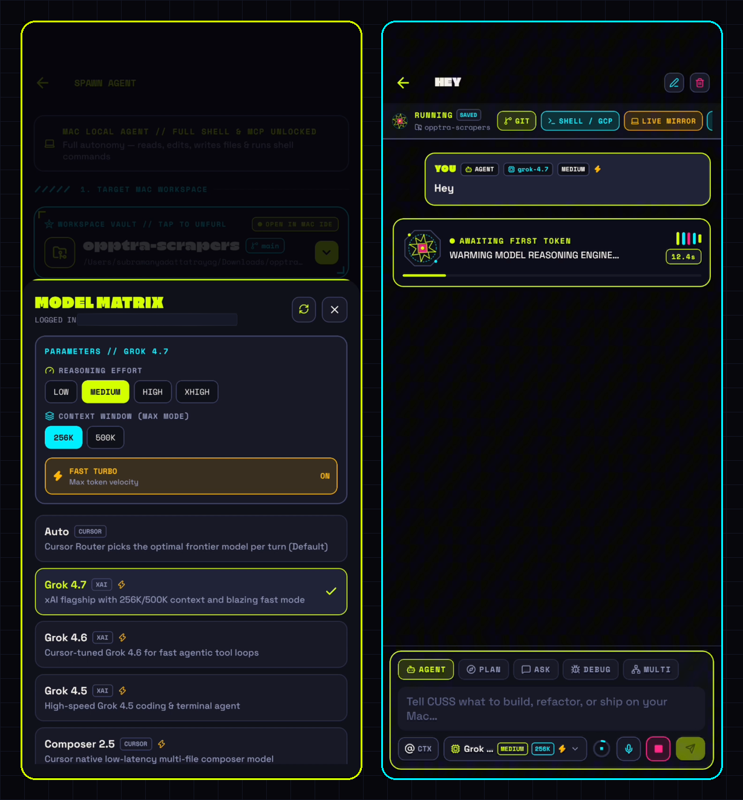
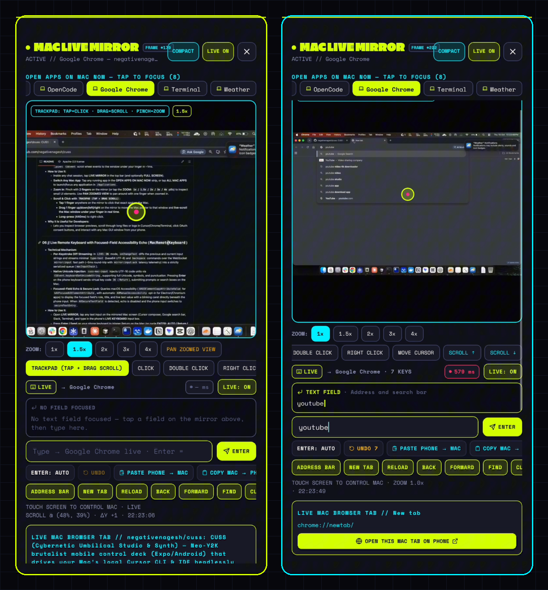

<div align="center">



# CUSS — Cybernetic Umbilical Studio & Synth

**A mobile engineering workstation for Android and iOS that drives your Mac's local Cursor CLI and IDE over a low-latency local bridge — with zero API keys, zero terminal setup, and full Cursor parity.**

[](https://github.com/negativenagesh/cuss/releases)
[](https://github.com/negativenagesh/cuss/releases)
[](https://github.com/negativenagesh/cuss/releases)
[](#verification-and-test-suite)
[](./LICENSE)

</div>

---

## Overview and Why CUSS Exists for Developers

Modern AI-assisted software development happens inside **Cursor** on a developer's workstation, where local repositories, Git credentials, SSH keys, Docker containers, MCP servers, and CLI tools live. However, the moment a developer steps away from their desk, they lose visibility and control over long-running agent tasks, test suites, Git branches, and browser OAuth flows.

**CUSS** solves this by turning your Android phone into a direct, low-latency remote control deck for your Mac's Cursor environment:

1. **Zero API Keys Required**: CUSS drives `/Applications/Cursor.app/Contents/Resources/app/bin/cursor agent` directly using your existing Cursor Pro or Ultra subscription.
2. **Works Even When the Cursor Desktop Window Is Closed**: Because the Mac bridge spawns the standalone `cursor-agent` binary headlessly in your project directory, you can spawn new sessions, stream token-by-token responses, and edit files on your Mac without keeping the Cursor GUI open.
3. **Zero-Terminal Background Operation**: The macOS installer (`cuss.dmg`) installs a native macOS Menu Bar companion (`/Applications/CUSS Menu.app`) and `launchd` background services that keep the Mac Bridge (`:4040`) running automatically on login.

---

## Visual Walkthrough: macOS Installer, Menu Bar App, and Mobile Control Deck

### 1. Self-Contained macOS Installer (`cuss.dmg` -> `Install CUSS.app`)

<p align="center">
  
  
</p>

- **Left**: Opening `cuss.dmg` and launching `Install CUSS.app` presents a native macOS Core Animation installer. Clicking **INSTALL CUSS** installs a bundled Node 22 (`arm64`) runtime, the NestJS Mac Bridge, precompiled native CoreGraphics/Accessibility helpers (`cuss-mac-input`, `cuss-mac-speech`), and `/Applications/CUSS Menu.app`. Target Macs do not need Node.js, npm, Xcode, or Terminal preinstalled.
- **Right**: Once installation completes, the installer automatically syncs your Cursor Desktop credentials, starts the background `com.cuss.bridge` and `com.cuss.menubar` LaunchAgents, verifies that port `4040` is healthy, and renders an instant **Pairing QR Code** on screen.

---

### 2. Native macOS Menu Bar Companion (`CUSS Menu.app`)

<p align="center">
  
</p>

- **How It Works**: Lives permanently in the top-right macOS status bar (`CUSS`). It polls the local bridge health endpoint (`http://127.0.0.1:4040/api/health`), monitors the optional Expo Go development bundler (`:8081`), and reads your active Cursor account from `~/Library/Application Support/Cursor/User/globalStorage/state.vscdb`.
- **How to Use It**:
  - Click **CUSS** in the top macOS menu bar at any time.
  - Click **Pair Phone — Show QR Code & Control HUD** to display the scannable pairing QR code (`missioncontrol://pair?url=...&token=...`) and live network telemetry.
  - Use **Copy Mac Bridge URL**, **Copy Pairing Token**, **Sync Cursor Desktop Login Now**, or **Restart Background Services** with one click.

---

### 3. Sessions Dashboard and Mac Working Directory Picker (`CUSS // SESSIONS`)

<p align="center">
  
</p>

- **Left**: The **Sessions Dashboard (`CUSS // SESSIONS`)** renders a 60fps pure SVG + Reanimated orbital reactor field where each orbiting satellite represents an active or recent Cursor session on your Mac, followed by the interactive Working Directory bar (`CHANGE DIR`, `ALL DIRS / THIS DIR` filter, `SYNC`) and persistent session cards.
- **Right**: Tapping **CHANGE DIR** (or **SELECT DIR** on the Landing screen) opens the **Mac Working Directory Picker**, listing all discovered Git repositories, branches, and worktrees alongside a full Mac folder browser (`GET /api/local/browse-dirs`).

---

### 4. Cursor Settings, Live Plan Usage Meters, and CLI / Editor Switches

<p align="center">
  
</p>

- **Left**: The **PLAN & USAGE** tab queries Cursor's `aiserver.v1.DashboardService/GetPlanInfo`, `GetCurrentPeriodUsage`, and `GetHardLimit` endpoints to display your subscription tier (`ULTRA · $200/mo`), three live usage bars (**Total Included Usage %**, **Auto / Composer 2.5 / Grok 4.7 Bucket %**, and **Named Frontier API Usage %**), USD compute spend breakdown (**Included Credit**, **Provider Bonus**, **Total Value Used**, **On-Demand Hard Cap**), and all included Auto-bucket models.
- **Right**: The **GENERAL & DIR** tab provides live switches that read and write `~/.cursor/cli-config.json` (`Max Mode`, `Disable Sandbox`, `Auto-Accept Web Search`, `Attribute Git Commits`, `Attribute PRs`, `Notifications`, `Vim Mode`) and Cursor Desktop's `settings.json` (`Git Autofetch`, `Terminal Inline Images`, `Auto-Detect OS Color Scheme`, `Format On Save`).

---

### 5. Model Matrix (`Grok 4.7`, `Composer 2.5`, `Auto`) and Live Agent Streaming

<p align="center">
  
</p>

- **Left**: Opening the **Model Matrix** lets you select any frontier model family (`Auto`, `Grok 4.7`, `Grok 4.6`, `Grok 4.5`, `Composer 2.5`, `Claude Opus`, `GPT-5.4`) and configure **Reasoning Effort** (`LOW`, `MEDIUM`, `HIGH`, `XHIGH`), **Context Window** (`256K`, `500K`, `1M`), and **Fast Turbo** mode.
- **Right**: Spawning or prompting an agent streams real-time NDJSON events (`thinking`, `tool_call`, `assistant`) over WebSocket with direct shortcuts to **GIT**, **SHELL / GCP**, **LIVE MIRROR**, and **SETTINGS**.

---

### 6. Pinch-to-Zoom Mac Live Mirror, Pointer Trackpad Scroll, and 5ms Live Remote Keyboard

<p align="center">
  
</p>

- **Left**: Inside **MAC LIVE MIRROR**, pinch with two fingers (or tap the `1x / 1.5x / 2x / 3x / 4x` pills) to zoom into any part of your Mac display. Dragging one finger in **TRACKPAD (TAP + DRAG SCROLL)** mode moves the Mac pointer to that window and live-scrolls the Mac window under your finger via native `CGEvent` wheel injection (`scrollat`).
- **Right**: Tapping any input field on the mirrored Mac screen (such as Google Chrome's address bar or Cursor's composer) activates the **Focused-Field Accessibility Echo** (`AXFocusedUIElement`) with a live blinking caret. Every keystroke typed on your phone streams into the active Mac window in ~5ms over WebSocket (`mirror:input`), and pressing **Enter** triggers a native `Return` key on the Mac.

---

## Technical Capabilities and How to Use Each Feature

### 01 // Zero-Terminal Cursor Authentication (`state.vscdb` + Mobile PKCE OAuth)

- **Technical Mechanism**:
  - Cursor's headless `cursor-agent` binary includes a `FileCredentialManager` activated by setting `AGENT_CLI_CREDENTIAL_STORE=file`, which reads `{ accessToken, refreshToken }` from `~/.cursor/auth.json` (`0600`).
  - On startup, the CUSS Mac Bridge queries `Cursor.app`'s local SQLite state database (`~/Library/Application Support/Cursor/User/globalStorage/state.vscdb`, table `ItemTable`, keys `cursorAuth/accessToken` and `cursorAuth/refreshToken`) and writes `~/.cursor/auth.json` automatically.
  - If `Cursor.app` is not signed in on the Mac, the mobile app generates a cryptographic PKCE challenge (`uuid`, `verifier`, SHA-256 base64url `challenge`) in 0.1ms, opens `https://cursor.com/loginDeepControl` in your phone's browser, polls `https://api2.cursor.sh/auth/poll`, and pushes the resulting tokens to `POST /api/local/auth/complete`.
- **How to Use It**:
  - If you are already signed into Cursor on your Mac, authentication is automatic on first launch.
  - If not signed in, tap **SIGN IN TO CURSOR TO CONTINUE** on the mobile landing screen and approve the login in Chrome or Brave on your phone.
- **Why It Is Useful for Developers**:
  - Eliminates manual `cursor agent login` terminal steps, SSH key forwarding, or copying API keys onto a mobile device.

---

### 02 // Cursor Settings, Plan Quota, and Spend Telemetry (`GET / POST /api/local/settings`)

- **Technical Mechanism**:
  - Queries Cursor's `aiserver.v1.DashboardService/GetPlanInfo`, `GetCurrentPeriodUsage`, and `GetHardLimit` endpoints over HTTPS using your local Cursor access token, and merges the response with `~/.cursor/cli-config.json`, `~/Library/Application Support/Cursor/User/settings.json`, `state.vscdb`, and `~/.cursor/mcp.json`.
- **How to Use It**:
  - Tap **SETTINGS** in the top bar of the Landing screen, the Sessions Dashboard (`CUSS // SESSIONS`), or any Agent Detail screen.
  - **PLAN & USAGE Tab**: Inspect your active subscription tier (`ULTRA` / `PRO`), billing cycle reset countdown, three live usage bars (**Total Included Usage %**, **Auto / Composer 2.5 / Grok 4.7 Bucket %**, and **Named Frontier API %**), USD compute spend breakdown (**Included Credit**, **Provider Bonus Credit**, **Total Compute Value Used**, and **On-Demand Hard Cap status**), the list of models included in the Auto bucket, and total input/output/cache-read tokens across your local CUSS sessions.
  - **GENERAL & DIR Tab**: Toggle Cursor CLI flags (`Max Mode`, `Disable Sandbox`, `Auto-Accept Web Search`, `Attribute Git Commits`, `Attribute PRs`, `Notifications`, `Vim Mode`) and Cursor Desktop editor preferences (`Git Autofetch`, `Terminal Inline Images`, `Auto-Detect OS Color Scheme`, `Format On Save`) — every toggle writes directly to `~/.cursor/cli-config.json` or `settings.json` on your Mac.
  - **MODELS & DEFAULTS Tab**: Configure your default execution mode, model family, reasoning effort, context window (`auto`, `256k`, `1M`), Fast mode, and Extended Thinking.
  - **PRIVACY & PLANS Tab**: Verify `PRIVACY_MODE_NO_TRAINING` / `Ghost Mode` status and open any saved Cursor architecture plan (`~/.cursor/plans/*.md`) in the in-app file viewer.
  - **MCP & BRIDGE Tab**: Inspect all configured MCP servers from `~/.cursor/mcp.json` and manage bridge pairing.
- **Why It Is Useful for Developers**:
  - Gives complete visibility into Cursor quota consumption and lets you switch to Auto-bucket models (`Auto`, `Composer 2.5`, `Grok 4.7`) before hitting named API limits.

---

### 03 // Mac Working Directory Selector and Folder Browser (`DirectoryPickerModal`)

- **Technical Mechanism**:
  - Combines automatic repository discovery (`discoverLocalProjects()` scanning active Cursor workspaces, `~/.cursor/projects`, Git worktrees, and `~/Downloads`) with a live filesystem directory browser (`GET /api/local/browse-dirs?path=...`) that detects `.git` repositories and active branch names.
  - Persists your chosen `selectedCwd` on the Android device (`cuss-device-state-v1.json`) and pre-populates new agent spawns.
- **How to Use It**:
  - **On the Main Landing Page (after Sign-In)**: Tap the **WORK DIR / SELECT DIR** row in the telemetry card to pick a discovered repository or browse any folder on your Mac (`~`, `Downloads`, parent `..`, or custom path). Tap **SPAWN AGENT IN <DIR>** to launch an agent directly in that directory.
  - **On the Sessions Dashboard (`CUSS // SESSIONS`)**: Tap the Working Directory bar beneath the header to switch directories at any time, toggle **THIS DIR / ALL DIRS** to filter sessions by directory, or tap **SPAWN** to start a new chat in the selected folder.
- **Why It Is Useful for Developers**:
  - Lets you hop across multiple repositories, monorepo packages, or Git worktrees from your phone without touching the Mac.

---

### 04 // 5-Mode Cursor Composer, Model Matrix, and `@file` Context Vault

- **Technical Mechanism**:
  - Replicates Cursor's five execution modes (`Agent`, `Plan`, `Ask`, `Debug`, `Multitask`) and passes the corresponding CLI flags and structured mode instructions to `cursor-agent --print --output-format stream-json --stream-partial-output --force --sandbox disabled --approve-mcps`.
  - Pre-warms chat session UUIDs (`create-chat`) in the background so dispatching a prompt begins streaming in milliseconds.
- **How to Use It**:
  - Select your mode pill (`AGENT`, `PLAN`, `ASK`, `DEBUG`, `MULTITASK`) and model (`Auto`, `Grok 4.7`, `Composer 2.5`, `Codex 5.3`, `Claude Opus`, etc.) in the bottom-pinned composer.
  - Tap **`@`** (or type `@filename`) to search workspace files via `GET /api/local/files` and attach `@file` context chips to your turn.
  - Tap the **Context Gauge (`%`)** pill to open the 9-category **Prompt Context Usage Explorer** (*System Prompt*, *Tool Definitions*, *Rules*, *Skills*, *MCP Servers*, *Subagents*, *Attached `@Files`*, *Prompt Cache*, and *Active Conversation*).
- **Why It Is Useful for Developers**:
  - Provides the same granular control over model selection, reasoning effort, context window, and file grounding as the desktop IDE.

---

### 05 // Zoomable Flicker-Free Mac Live Mirror and Pointer-Targeted Live Scroll

- **Technical Mechanism**:
  - **Single-Flight Atomic Capture**: The bridge captures the Mac display (`/usr/sbin/screencapture -x -C -t jpg`, including the live system cursor) into a staging file and atomically renames it, streaming base64 frames over WebSocket (`mirror:subscribe` -> `mirror:frame`).
  - **GPU Double-Buffered Canvas**: The mobile `DoubleBufferedMirrorCanvas` maintains two stacked `<Image>` buffers (Slot A and Slot B) and swaps visibility only inside `onLoad` after decoding finishes, eliminating frame flicker.
  - **2-Finger Pinch-to-Zoom (`1x` – `4x`) & Matrix Inversion**: Pinching with two fingers scales (`1.0x` to `4.0x`) and pans the viewport. Every touch event inverts the `(translateX, translateY, scale)` transformation matrix before mapping to normalized Mac screen coordinates `(nx, ny) in [0, 1]`.
  - **Native CoreGraphics Pointer & Scroll Daemon (`cuss-mac-input.swift`)**: A persistent native Swift daemon reads commands over stdin (`click`, `doubleclick`, `rightclick`, `move`, `moverel`, `scrollat <nx> <ny> <dy> <dx>`), warps the Mac cursor (`CGWarpMouseCursorPosition`), and posts both `.line` and `.pixel` `CGEvent` scroll wheel events to the window under your finger in ~1ms.
- **How to Use It**:
  - Inside any chat session, tap **LIVE MIRROR** in the top bar (and optionally **FULL SCREEN**).
  - **Switch Any Mac App**: Tap any running app in the **OPEN APPS ON MAC NOW** strip, or tap **ALL MAC APPS** to launch/focus any application in `/Applications`.
  - **Zoom In**: Pinch with **2 fingers** on the mirror (or tap the **ZOOM: `1x` / `1.5x` / `2x` / `3x` / `4x`** pills) to inspect small UI elements. Use **PAN ZOOMED VIEW** to pan around with one finger when zoomed in.
  - **Scroll & Click with `TRACKPAD (TAP + DRAG SCROLL)`**:
    - **Tap 1 finger** anywhere on the mirror to click that exact spot on the Mac.
    - **Drag 1 finger up/down/left/right** on the mirror to move the Mac pointer to that window and **live-scroll the Mac window under your finger in real time**.
    - **Long-press (440ms)** to right-click.
- **Why It Is Useful for Developers**:
  - Lets you inspect browser previews, scroll through long files or logs in Cursor/Chrome/Terminal, click OAuth consent buttons, and interact with any Mac GUI window from your phone.

---

### 06 // Live Remote Keyboard with Focused-Field Accessibility Echo (`MacRemoteKeyboard`)

- **Technical Mechanism**:
  - **Per-Keystroke Diff Streaming**: In `LIVE: ON` mode, `onChangeText` diffs the previous and current input strings and streams minimal `type-text` (base64 UTF-8) and `backspace` commands over the WebSocket `mirror:input` fast path (~5ms round-trip with `mirror:input:ack` latency telemetry) into a strictly serialized queue (`macInputChain`).
  - **Native Unicode Injection**: `cuss-mac-input` injects UTF-16 code units via `CGEvent.keyboardSetUnicodeString`, supporting full Unicode, symbols, and punctuation. Pressing **Enter** on the phone keyboard sends virtual key code `36` (`Return`), submitting prompts or search boxes on the Mac.
  - **Focused-Field Echo & Secure Lock**: Queries macOS Accessibility (`AXUIElementCopyAttributeValue` for `kAXFocusedUIElementAttribute`, with automatic `AXManualAccessibility` opt-in for Electron/Chromium apps) to display the focused field's role, title, and live text value with a blinking caret directly beneath the phone input. When `AXSecureTextField` is detected, echo is disabled and the phone input switches to `secureTextEntry`.
- **How to Use It**:
  - Open **LIVE MIRROR**, tap any text input on the mirrored Mac screen (Cursor composer, Google search bar, Slack, Terminal), and type in the phone's **LIVE KEYBOARD** input box.
  - Press **Enter / Send** on your phone keyboard to trigger Return on the Mac (or cycle **ENTER: AUTO / Return / Cmd+Return / Shift+Return** per app).
  - Use **UNDO** to reverse your last typed burst, **PASTE PHONE -> MAC** (`pbcopy` + `Cmd+V`), **COPY MAC -> PHONE** (`pbpaste`), **DICTATE -> MAC** (voice transcription via `cuss-mac-speech` / `SFSpeechRecognizer`), or the **Per-App Quick Action Rails** (for Cursor, VS Code, Chrome, Safari, Terminal, Slack, Finder, and Notes).
- **Why It Is Useful for Developers**:
  - Turns your phone into a real-time wireless keyboard, voice dictation mic, and shortcut deck for any focused Mac application.

---

### 07 // Universal In-App File Viewer, Live Git Studio, and Mac Zsh Terminal

- **Universal File Viewer (`FileViewerModal`)**:
  - **How to Use**: Tap any `@file` chip, inline file path in assistant prose, tool-call file card, or changed file in Git Studio.
  - **What It Renders**: Syntax-highlighted source code with line numbers and live line search, rendered Markdown previews, formatted CSV/TSV data tables, inline images (`png`/`jpg`/`webp`/`gif`), or binary hex/metadata views.
- **Live Git Studio (`GET /api/local/git-diff` & `POST /api/local/git-action`)**:
  - **How to Use**: Tap **GIT** in the top bar of any Mac agent session.
  - **Capabilities**: View uncommitted changed files (`M`, `A`, `D`, `??`), inspect color-coded unified diffs, switch branches, create new branches (`checkout -b`), write a commit message to stage & commit (`git add -A && git commit`), and run `git pull` / `git push`.
- **Unrestricted Mac Shell & OAuth Link Catcher (`POST /api/local/exec-shell`)**:
  - **How to Use**: Tap **SHELL / GCP** in the top bar to run one-tap presets (`git status`, `gcloud auth status`, `gcloud config list`, `npm test`) or arbitrary `zsh` commands in the workspace directory.
  - **OAuth Detection**: Automatically extracts `https://...` login URLs from command output so you can open them in your phone browser or on the Mac browser.

---

## All Ways to Build, Install, and Use CUSS

CUSS supports multiple deployment and development workflows depending on whether you want a zero-terminal appliance setup, an interactive development setup with Expo Go, or custom self-built binaries.

---

### Method 1 — Zero-Terminal Prebuilt Release (`cuss.dmg` + `cuss.apk`)

Best for end users who want to install CUSS without installing Node.js, npm, Xcode, or running any terminal commands.

1. Download **`cuss.dmg`** (macOS Apple Silicon installer) and **`cuss.apk`** (Android standalone application) from [**GitHub Releases**](https://github.com/negativenagesh/cuss/releases).
2. **On your Mac**:
   - Double-click **`cuss.dmg`** to mount the disk image, then double-click **`Install CUSS`** (on first launch, right-click -> **Open** to allow the ad-hoc signed installer).
   - Click **INSTALL CUSS**. The installer unpacks a self-contained Node 22 runtime, the Mac Bridge (`:4040`), and precompiled native helpers into `~/Library/Application Support/CUSS`, installs **`/Applications/CUSS Menu.app`**, registers the `com.cuss.bridge` and `com.cuss.menubar` LaunchAgents, syncs your Cursor Desktop token into `~/.cursor/auth.json`, and displays a **Pairing QR Code**.
   - When macOS prompts for permissions, grant **Accessibility** (for Live Keyboard injection and focused-field echo) and **Screen Recording** (for Live Mirror capture) to `node`.
3. **On your Android phone**:
   - Install and open **`cuss.apk`**.
   - If your phone and Mac are on the same Wi-Fi network, CUSS auto-discovers and pairs with your Mac bridge automatically; or tap **SCAN** and point the camera at the QR code shown in the macOS installer or in **CUSS -> Pair Phone** in the Mac menu bar.

---

### Method 2 — Source Install with Native macOS Menu Bar and Background Daemons (`npm run menubar:install`)

Best for developers who clone the repository once and want both the Mac Bridge (`:4040`) and the Expo Go bundler (`:8081`) to run permanently in the background on macOS login — with zero terminal windows open.

```bash
git clone https://github.com/negativenagesh/cuss.git
cd cuss

# Install dependencies in bridge/ and mobile/:
npm --prefix bridge install
npm --prefix mobile install

# Build native Swift helpers + install /Applications/CUSS Menu.app + start LaunchAgents:
npm run native:build
npm run menubar:install
```

**How to use after running `npm run menubar:install`**:
- Three macOS `LaunchAgents` (`RunAtLoad: true`, `KeepAlive: true`) now run automatically in the background whenever you log into your Mac:
  1. `com.cuss.bridge` (Port `4040` — Mac Cursor Bridge + native input daemon)
  2. `com.cuss.expo` (Port `8081` — Expo Go Metro server with automatic `--clear` cache hygiene)
  3. `com.cuss.menubar` (`CUSS` status item in your top macOS menu bar)
- Click **CUSS** in your top Mac menu bar -> **Pair Phone — Show QR Code & Control HUD** to scan either the **CUSS APK Pairing QR** (`missioncontrol://pair?...`) or the **Expo Go QR** (`exp://<MAC_LAN_IP>:8081`).

---

### Method 3 — Single-Terminal Interactive Development (`npm start`)

Best when actively modifying `bridge/src/*` or `mobile/src/*` and testing changes live with Fast Refresh in the **Expo Go** app (Android or iOS).

```bash
git clone https://github.com/negativenagesh/cuss.git
cd cuss

# Starts the Mac Bridge (:4040) in the background, prints pairing credentials,
# and launches the interactive Expo Go bundler (:8081) in the same terminal:
npm start
```

**Other direct development commands**:
```bash
# Run only the Mac Bridge in watch mode (:4040):
npm run bridge:dev

# Run only the Mac Bridge in production mode (:4040):
npm run bridge:start

# Run only the Expo Metro bundler (:8081) with clean cache:
cd mobile && npx expo start --port 8081 --clear
```

---

### Method 4 — Headless Background Bridge Service Only (`npm run service:install`)

Best if you use the standalone **`cuss.apk`** on your Android phone and only need port `4040` (`com.cuss.bridge`) running in the background on your Mac without the Expo Metro development server (`:8081`).

```bash
# Install and start ~/Library/LaunchAgents/com.cuss.bridge.plist (:4040):
npm run service:install

# Inspect live bridge logs:
tail -f /tmp/cuss-bridge.log

# Uninstall the background bridge service if no longer needed:
npm run service:uninstall
```

---

### Method 5 — Building Distributable Artifacts from Source (`cuss.dmg` and `cuss.apk`)

#### 5A. Build the Self-Contained macOS Disk Image (`dist/cuss.dmg`)
Requires macOS with Xcode Command Line Tools (`swiftc`, `iconutil`, `hdiutil`, `codesign`) and Node.js 20+:

```bash
# 1. (Optional) Regenerate all icons, splash screens, DMG background, and CUSS.icns:
npm run brand:assets

# 2. Precompile native Swift helpers (bridge/bin/cuss-mac-input & cuss-mac-speech):
npm run native:build

# 3. Compile Install CUSS.app + CUSS Menu.app, bundle Node runtime + bridge, and create dist/cuss.dmg:
npm run dmg
```
Output: `dist/cuss.dmg` (~59 MB).

#### 5B. Build the Standalone Android APK via Expo EAS Cloud (`dist/cuss.apk`)
Requires an Expo account (`npx eas-cli login`), with no local Android SDK or Java required on your Mac:

```bash
# 1. Authenticate with Expo EAS once:
cd mobile && npx eas-cli login && cd ..

# 2. Trigger a cloud release APK build (uses the "apk" profile in mobile/eas.json):
npm run apk

# 3. Download the latest finished APK into dist/cuss.apk:
npm run apk:download
```

#### 5C. Build the Standalone Android APK Locally Offline (Gradle + Android SDK)
If you have JDK 17 (`JAVA_HOME`) and the Android SDK (`ANDROID_HOME`) installed locally on your Mac:

```bash
cd mobile
npx expo prebuild --platform android --clean
cd android
./gradlew assembleRelease
```
Output: `mobile/android/app/build/outputs/apk/release/app-release.apk`.

---

### Method 6 — Using CUSS Remotely Outside Local Wi-Fi (Tailscale / Mesh VPN)

When your Mac and phone are on the same Wi-Fi LAN, CUSS connects directly to `http://<MAC_LAN_IP>:4040`. To use CUSS over 5G cellular or from any remote network:

1. Install [**Tailscale**](https://tailscale.com) on both your Mac and your Android phone and sign into the same Tailnet.
2. Find your Mac's Tailscale IPv4 address (`100.x.y.z`) by clicking the Tailscale menu bar icon or running `tailscale ip -4`.
3. In the CUSS mobile app pairing screen, enter:
   - **Bridge URL**: `http://<YOUR_MAC_TAILSCALE_IP>:4040`
   - **Pairing Token**: Copy from **CUSS -> Copy Pairing Token** in your Mac menu bar (or from `~/.config/mission-control/config.json`).

---

## Verification and Test Suite

Run the full test and static type-verification suite from the repository root:

```bash
npm test
```

| Check | Command | Status |
| :--- | :--- | :--- |
| **Bridge Unit & Integration Tests** | `npm --prefix bridge test` | **4 test suites · 31/31 tests passing** (`auth.spec.ts`, `cursor-api.spec.ts`, `local-agent.spec.ts`, `model-catalog.spec.ts`) |
| **Bridge TypeScript Strict Check** | `./bridge/node_modules/.bin/tsc -p bridge/tsconfig.json --noEmit` | **0 errors** |
| **Mobile TypeScript Strict Check** | `./mobile/node_modules/.bin/tsc -p mobile/tsconfig.json --noEmit` | **0 errors** |
| **Expo Doctor Validation** | `cd mobile && npx expo-doctor` | **21/21 checks passed** |

---

## License

Licensed under the [Apache License, Version 2.0](./LICENSE).
